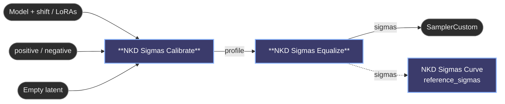

# 😺NKD Sigmas Calibrate + Equalize

Instead of picking a scheduler from a list, measure one. **Calibrate** runs a single
long reference pass and watches how much the predicted final image changes at every
noise level. **Equalize** spreads your steps over that profile so each one does a
comparable share of the work: dense where the image is still moving, sparse where
little happens.

They are two nodes so the slow part runs once. Calibrate stays cached while you play
with `steps` and `equalize`, which reschedule instantly.

It only reads the model's own prediction, so it works on any model ComfyUI can
sample, including DiT and flow models that have no Align Your Steps table.

Calibrate:

- `scheduler` + `calib_steps` set the reference pass (Euler). More steps give a finer
  profile but take longer.
- `seed` has no randomize control on purpose: a seed that changed every run would
  throw the cached calibration away each time.
- The console prints the measured change per step.
- `latent` and `image` are the result of the reference pass, cached with the profile.
  Use them as the baseline to compare your final render against. `image` needs the
  optional `vae`; without it you get a black placeholder.

Equalize:

- `steps` is the length of the schedule you get back.
- `equalize` is how far to go. At 0 you get the reference scheduler resampled to `steps`,
  so nothing changes. At 1 every step moves the image by the same amount. Start around
  0.5. Full equalisation starves the last steps, because fine detail barely registers
  next to the early composition moves.
- The console prints the resulting sigmas and how uneven the per-step change was before
  and after (max/min ratio).

Calibrate with the same model patches (shift, LoRAs), CFG and resolution you will sample
with, because the profile depends on all of them. A latent batch larger than 1 averages
the profile over several seeds, which is better than trusting a single one.

### Video

Video and audio+video latents work as they are (with audio+video, the video part is
what gets measured). Calibrating a long clip is slow, but it only runs once.

Models with two experts, like Wan 2.2, need both: connect the low-noise model to
`model_low` and set `boundary` to the sigma where it takes over (0.875 for T2V, 0.9 for
I2V). Equalize then gives you `split_step`; feed it to **SplitSigmas** and run the high
half with the first model and the low half with `model_low`. Single models such as
MiniMax H3 leave `model_low` empty.

To see the result or keep editing it, wire the output into **Sigmas Curve**'s
`reference_sigmas` and press **Match**.

Few-step distilled models and LoRAs (Lightning, DMD, Turbo) already have their schedule
baked in and gain little from this.

---

[← All 😺NKD Sigmas Curve nodes](../README.md)
